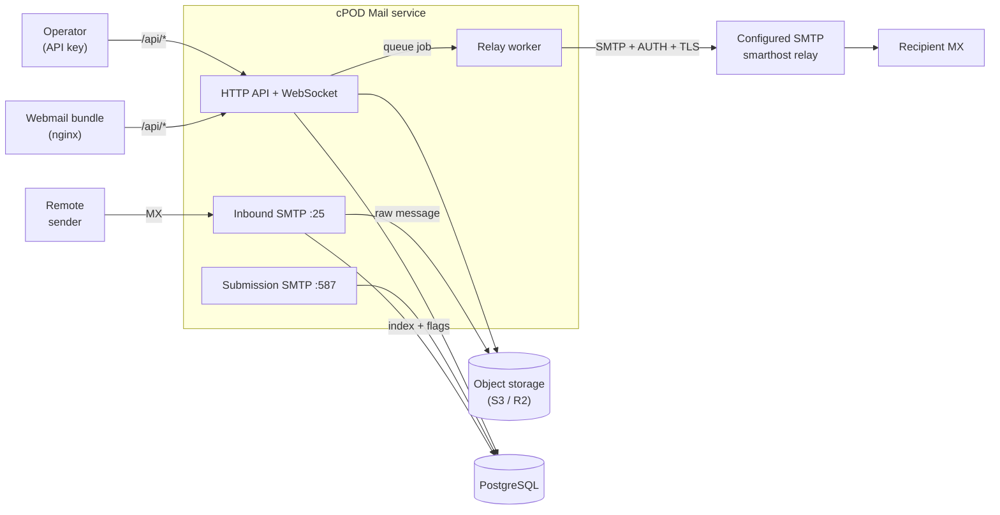
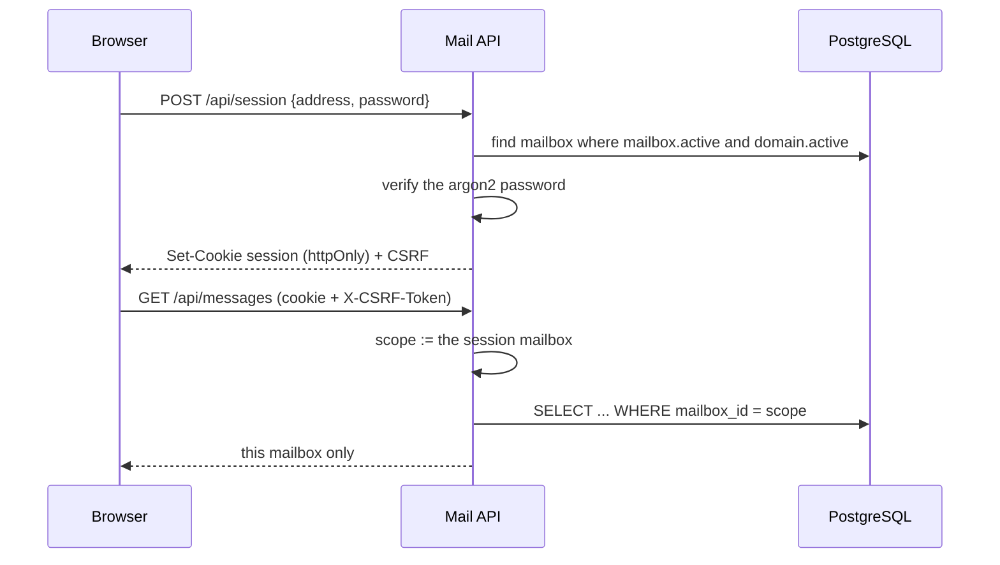
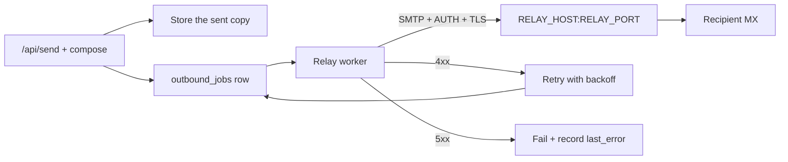

# cPOD Mail

The cPOD Mail service for CopodServices. It accepts SMTP for the domains it
owns, verifies the message, stores it in S3 and indexes it in PostgreSQL, and
serves a multi-tenant webmail client over its HTTP API. Every outbound message
is handed to one configured SMTP smarthost, which signs (DKIM) and delivers it;
this service never delivers directly to a recipient's MX, and the relay is a
configuration choice rather than a dependency.

## What it does

- **Inbound (:2525 locally, :25 in production)** — EHLO advertises SIZE, 8BITMIME,
  PIPELINING, ENHANCEDSTATUSCODES and STARTTLS when a certificate is configured.
  Each RCPT is validated against a local mailbox; unknown recipients are refused
  with 550, so the listener can never be used as an open relay. On DATA the
  message is parsed (mail-parser), authenticated (SPF/DKIM/DMARC via mail-auth),
  written to S3 and indexed in PostgreSQL. A DMARC failure with a rejecting
  policy is refused with 550; a quarantining policy stores the message with
  status quarantined. A mailbox at its `quota_bytes` limit refuses the message
  with a temporary 451 and stores nothing, so the sender retries later. A
  mailbox with an auto-forward address queues a copy of every arrival to it,
  with only the envelope sender rewritten (SRS), so the forwarded message keeps
  its own authentication; a relay that refuses the sender's domain gets the copy
  rewritten to go out as the mailbox.
- **Submission (:2587 locally, :587 in production)** — requires AUTH (PLAIN or
  LOGIN, argon2 password hashes) and the envelope sender must match the
  authenticated mailbox. Mail to a local mailbox is stored; anything else is
  queued for the relay. A Bcc header the client submitted is kept on the
  sender's own copy alone: a copy stored in another mailbox, and the copy the
  relay is handed, are stripped of it before they are written.
- **Relay worker** — claims queued messages and hands the stored bytes to the
  smarthost over STARTTLS or implicit TLS with AUTH, retrying with exponential
  backoff (capped at six hours). A permanent 5xx rejection (bad SPF/DKIM/MX, an
  unapproved sending domain, bad credentials, rate limits) fails the job at once
  and is recorded in outbound_jobs.last_error.

## Components

The SMTP server loop, spooling and delivery are ours; the protocol work comes
from Stalwart's libraries. Stalwart's mail server itself is not embeddable, so
there is no server library to reuse.

| Crate | Used for |
| --- | --- |
| smtp-proto | parsing SMTP commands and building replies |
| mail-parser | MIME parsing, subject/sender/message-id metadata |
| mail-auth | SPF, DKIM and DMARC verification of inbound mail |
| mail-builder | composing API-submitted messages |

## Local development

Requires Docker, and a Rust toolchain (edition 2024).

    cp .env.example .env
    make up            # Postgres, an S3 mock (bucket created), Mailpit
    make migrate
    make dev           # inbound :2525, submission :2587, HTTP API :8080

The stack is fully offline: Postgres, an S3-compatible mock and Mailpit. Mailpit
(http://localhost:8025) is the relay target, so anything the service relays shows
up there. API docs are at http://localhost:8080/scalar.

Smoke test the inbound path (the .env seeds postmaster@example.test):

    curl -sS -X POST http://localhost:8080/api/send \
      -H 'content-type: application/json' \
      -d '{"from":"postmaster@example.test","to":["postmaster@example.test"],
           "subject":"hello","text":"first message"}'

    curl -sS http://localhost:8080/api/messages | head -c 400

## HTTP API

Callers are either the operator (Authorization: Bearer <API_KEY>, which manages
every tenant) or a mailbox session from POST /api/session. Without an API key
an unauthenticated caller is treated as the operator, which is how the local
examples below run.

| Method | Path | Purpose |
| --- | --- | --- |
| GET | /api/messages | List stored mail, newest first. Filters: mailbox, mailbox_id, folder, direction, q, read, starred, limit, cursor |
| GET | /api/messages/counts | Per-folder and per-mailbox totals and unread counts |
| GET | /api/messages/{id} | Message with body (text/html) and the attachment list |
| GET | /api/messages/{id}/raw | Raw RFC5322 message from S3 |
| GET | /api/messages/{id}/attachments/{index} | One attachment by position; `?preview=1` serves a renderable part inline for preview |
| POST | /api/messages/{id}/read | Set read state ({read}) |
| POST | /api/messages/{id}/star | Set starred state ({starred}) |
| POST | /api/messages/{id}/snooze | Snooze until a time ({snoozed_until}) |
| GET | /api/messages/{id}/metadata | Attachments and the unsubscribe link |
| POST | /api/messages/{id}/cancel-schedule | Cancel a scheduled send (returns it to Drafts) |
| DELETE | /api/messages/{id}/snooze | Return it to the inbox now |
| GET | /api/messages/navigation | Ordered ids and unread flags for the open filter |
| GET | /api/messages/{id}/thread | The conversation, with bodies and attachments |
| POST | /api/messages/empty | Empty trash or spam ({mailbox_id, folder}) |
| POST | /api/messages/bulk | Act on many messages ({message_ids, action, folder}) |
| DELETE | /api/messages/{id} | Remove the row and the stored object |
| GET | /api/folders | System and custom folders for a mailbox |
| POST | /api/folders | Create a custom folder ({mailbox_id, name, color}) |
| GET | /api/mailboxes | List mailboxes with `used_bytes` and `quota_bytes` (a session sees only its own; ?domain=<name> filters) |
| POST | /api/mailboxes | Create a mailbox ({address, password}) |
| DELETE | /api/mailboxes/{address} | Delete a mailbox |
| PATCH | /api/mailboxes/{address} | {signature, display_name, forward_to, password, quota_bytes, active}; a session may set only its own signature, display name and forwarding address |
| GET | /api/domains | List domains |
| POST | /api/domains | Create a tenant domain (idempotent) |
| GET | /api/domains/{name} | One domain |
| PATCH | /api/domains/{name} | Set {active}; a disabled tenant stops sending and receiving |
| DELETE | /api/domains/{name} | Remove a domain and its mailboxes |
| GET | /api/attachment-policy | Attachment limits for the composer |
| GET/POST | /api/templates, GET/DELETE /api/templates/{id} | Composer templates |
| GET/PATCH | /api/settings/shortcuts, /api/settings/recipient-addresses | Client preferences |
| GET | /api/settings/clients | Submission host, port, TLS mode and username for another mail app |
| GET | /api/contacts | A contact for an address |
| PATCH | /api/contacts | Rename a contact |
| POST | /api/contacts/block | Block a sender |
| GET/POST/DELETE | /api/contacts/avatar | Contact picture, full or preview |
| GET | /api/realtime | WebSocket pushing a frame per stored message |
| POST | /api/drafts | Create a draft ({mailbox_id, from, to, cc, bcc, subject, text, html, in_reply_to, references_header, thread_id, forward_of_message_id}) |
| GET/PATCH/DELETE | /api/drafts/{id} | Read, update or discard a draft |
| POST | /api/drafts/{id}/attachments | Upload attachments (multipart) |
| DELETE | /api/drafts/{id}/attachments/{index} | Remove an attachment |
| POST | /api/send | Compose and deliver ({from, to, cc, bcc, subject, text, html, draft_id, scheduled_at}) |

Reader state (read, starred, folder) lives in its own table, message_flags, so
the MTA's stored messages stay immutable.

## Configuration

| Variable | Purpose |
| --- | --- |
| DATABASE_URL | PostgreSQL connection for the mail database |
| SESSION_SECRET | HS256 key for webmail session cookies |
| SESSION_COOKIE_SECURE | Marks the session cookie Secure (default true) |
| API_KEY | Operator bearer token: manages every tenant (empty disables auth) |
| SMTP_LISTEN / SUBMISSION_LISTEN | Listener addresses (0.0.0.0:2525 / :2587) |
| MAIL_HOSTNAME | EHLO name of this server |
| MAIL_DOMAINS | Domains to accept mail for |
| MAIL_BOOTSTRAP_PASSWORD | Optional password for the seeded postmaster mailbox |
| MAX_MESSAGE_SIZE / MAX_RECIPIENTS | Limits (25 MiB / 50) |
| MAIL_VERIFY_AUTH | Enable SPF/DKIM/DMARC verification on inbound |
| S3_* | Endpoint, region, bucket and credentials (path style works for the mock, R2 and S3) |
| RELAY_* | SMTP smarthost: host, port, TLS mode, AUTH and optional sender rewrite (see Relay) |
| TLS_CERT_PATH / TLS_KEY_PATH | PEM pair enabling inbound STARTTLS |

## Multitenancy and authentication

A tenant is a domain. Domains and mailboxes are created only through the
operator API (Authorization: Bearer API_KEY); the web client has no admin
surface. End users sign in with their mailbox address and password:

| Method | Path | Purpose |
| --- | --- | --- |
| POST | /api/session | {address, password} -> set the session and CSRF cookies |
| GET | /api/session | The signed-in mailbox |
| DELETE | /api/session | Clear the cookies |

The session cookie is httpOnly (the CSRF cookie is readable) and the API pins
every request from a session to that one mailbox: lists, reads, writes, drafts,
contacts, templates, preferences and the realtime socket are all scoped, and
another mailbox answers 404. Cookie-authenticated writes must send the CSRF
value back in X-CSRF-Token. The operator key is not a session: it still sees
every tenant.

The web client is served from the API's own origin — the container's nginx
proxies /api/* — so the session cookie is first-party and the API sends no CORS
headers. A webmail on another origin belongs behind a proxy that makes its calls
same-origin, not in a cross-origin cookie setup.

## Relay

Outbound mail is never delivered directly. The queue worker hands the stored
bytes to one configured SMTP smarthost over STARTTLS or implicit TLS with AUTH.
The provider is configuration, not code, so switching later is an env change
plus that provider's DNS records.

| Variable | Purpose |
| --- | --- |
| RELAY_HOST / RELAY_PORT | Smarthost address |
| RELAY_TLS | none, starttls (default) or implicit |
| RELAY_USERNAME / RELAY_PASSWORD | SMTP AUTH (PLAIN); leave empty for an unauthenticated relay |
| RELAY_FROM | Optional envelope-sender rewrite some providers require |
| RELAY_MAX_ATTEMPTS | Retry ceiling before a job is failed (default 8) |

The relay signs DKIM for the sending domain. This service holds no DKIM keys, so
deliverability depends on the provider's signature and on the per-domain
authentication records it asks for, typically SPF, a return-path CNAME, a DKIM
CNAME and DMARC. Mailpit stands in for the relay in local development.

### Current provider: Jetemail

RELAY_HOST=relay.jetsmtp.net (EU: relay-eu.jetsmtp.net), RELAY_PORT=587,
RELAY_TLS=starttls, and one shared SMTP user from the Jetemail dashboard. Add
every tenant domain there and publish its records: SPF
`v=spf1 include:spf.jetsmtp.net ~all`, the DKIM CNAME
`jetemail._domainkey.<domain>` -> `dkim.jetsmtp.net`, the return-path CNAME the
dashboard assigns, DMARC `v=DMARC1; p=none` (the minimum), and an MX pointing
at this service (Jetemail rejects a sending domain without one). Approve each
domain on the SMTP user, or enable allow-any-domain and rely on SPF alone.

To move to another provider, change the RELAY_* values, create the equivalent
SMTP credential there, and publish that provider's authentication records for
each domain. Nothing else in the service changes.

## Layout

| Crate | Contents |
| --- | --- |
| mailcore | Config, S3 storage, auth policy, relay client, queue worker, persistence |
| entity | SeaORM entities |
| migration + migrator | Schema migrations and the one-shot runner |
| server | The mail binary: SMTP listeners, HTTP API, bootstrap |

## Deployment notes (out of scope for now)

Receiving public mail needs a real TCP port 25 on a public address with matching
PTR, which the Cloudflare Tunnel used by the other services cannot carry. When we
deploy, the split is: forward port 25 to the cluster (or run on a host with its
own public address), publish an MX record, PTR/rDNS for the sending hostname,
the SPF and DKIM records your relay provider lists for each domain, and a DMARC
policy. Certificates for STARTTLS are supplied through TLS_CERT_PATH/TLS_KEY_PATH.

## Web client

web/ is the cPOD Mail web client: a static, client-rendered mail reader for this
API (inbox and threads, compose and send, sent, drafts, spam, trash, starred,
snoozed, archived, folders, search). It is built with bun, formatted with
Biome, and shipped as a static bundle served by nginx, which also proxies /api/*
to this service. It calls the API's own /api/* endpoints and signs in with a
mailbox address and password; the API answers with an httpOnly session cookie,
so the browser bundle holds no long-lived credential of its own.

CI builds it on every pull request and pushes `ghcr.io/copodservices/mail-web`
on main, next to the API image `ghcr.io/copodservices/mail`.

    make web-install       # or: cd web && bun install
    make web-dev           # http://localhost:3002
    make web-build         # static export into web/out
    make web-test          # bun test (set MAIL_API_URL for the contract suite)
    docker build -t copod-mail-web web
    make web-up            # docker compose up -d --build web (http://localhost:3002)

See web/README.md, docs/mail-api.md, and NOTICE for the contract and the
Mailflare attribution.
